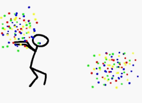

# Dotfiles .:.



My config files for macOS, Linux, Windows, and WSL, managed with
[`chezmoi`](https://www.chezmoi.io/). `chezmoi` renders the real files from
[Go templates](https://masterminds.github.io/sprig/) instead of symlinking, so
one branch covers every machine.

## Install

macOS / Linux / WSL:

```sh
sh -c "$(curl -fsLS https://raw.githubusercontent.com/nixpulvis/dotfiles/master/install.sh)"
```

Windows (PowerShell):

```powershell
irm https://raw.githubusercontent.com/nixpulvis/dotfiles/master/install.ps1 | iex
```

Both install `chezmoi` to `~/.local/bin` if it's missing, then run
`chezmoi init --apply nixpulvis`. On macOS, `install.sh` first installs the
Xcode Command Line Tools, since a new Mac has no working git. Extra arguments go
to `chezmoi init`, so `./install.sh --branch <branch>` tracks a branch.

If `chezmoi` is already installed:

```sh
chezmoi init --apply nixpulvis
```

## Components

| Group       | Applies to                                  | Contents                                               |
| ----------- | ------------------------------------------- | ------------------------------------------------------ |
| `base`      | everywhere                                  | git, bash, fish, vim/nvim, weechat, omp, `~/.bin`      |
| `graphical` | macOS/Windows always, Linux by prompt       | alacritty + fonts                                      |
| `wm`        | Linux only, by prompt (implies `graphical`) | sway, i3, i3blocks, rofi, zathura, `.xinitrc`, `.X`    |

`chezmoi init` asks for git name, email, and signing key, an IRC nick, and
whether to set up the WeeChat ZNC login. On Linux it also asks whether the
machine is graphical (defaults to no on WSL) and whether to install the `wm`
stack. The answers are saved per machine and reused on later runs. Use
`chezmoi init --prompt` to answer them again.

The gating is in [`home/.chezmoiignore`](home/.chezmoiignore) and the prompts
are in [`home/.chezmoi.toml.tmpl`](home/.chezmoi.toml.tmpl). A few things are
also gated by OS: `~/.bin/share-network` is Linux only and WeeChat is skipped
on Windows.

`.chezmoi.toml.tmpl` is the template for this machine's `chezmoi` config,
`~/.config/chezmoi/chezmoi.toml`. `chezmoi init` renders it, which asks the
questions above and detects WSL, and saves the results in the config's `[data]`
section. Every other template reads them from there (e.g. `.graphical` or
`.ircnick`). Only `chezmoi init` renders it, so when it changes (your edit or a
pull) the saved config is stale until you re-run init. The
`run_before_00-config-drift-check` script catches this and prints a banner.
`chezmoi apply` keeps going, `chezmoi update` stops. Run `chezmoi update --init`
(or `chezmoi init`) to regenerate the config from your saved answers.

### Packages

Packages are listed in
[`home/.chezmoidata/packages.yaml`](home/.chezmoidata/packages.yaml), grouped
by component, with the name for each package manager:

```yaml
- {name: ripgrep, brew: ripgrep, pacman: ripgrep, apt: ripgrep, winget: BurntSushi.ripgrep.MSVC}
```

`run_once_after_10-install-packages.{sh,ps1}.tmpl` installs them with Homebrew
on macOS, `pacman` or `apt` on Linux, and `winget` on Windows. Leave out a
manager's key and the package is skipped there. To add a tool, add a line to
the YAML.

omp (the oh-my-pi coding agent) isn't in any distro repo or winget. macOS gets
it from a Homebrew tap (the `omp` line in `packages.yaml`). Linux and Windows
download a pinned release binary into `~/.bin` with
`run_once_after_15-install-omp.{sh,ps1}.tmpl`. To upgrade, bump the version and
checksums in [`home/.chezmoidata/omp.yaml`](home/.chezmoidata/omp.yaml).

## Layout

```
.chezmoiroot                 points chezmoi at home/
install.sh / install.ps1     bootstrap scripts
home/                        chezmoi source (renders to ~/)
  .chezmoi.toml.tmpl         per-machine prompts
  .chezmoiignore             component gating
  .chezmoidata/              packages.yaml, omp.yaml, weechat.yaml
  .chezmoitemplates/         shared merge script for the WeeChat modify_ files
  dot_*                      files that become ~/.*
  run_before_*               config drift check, runs on every apply
  run_once_*                 one-time setup scripts
  AppData/                   Windows config-path symlinks (see below)
test/                        sandbox.sh (throwaway HOME), docker.sh (Linux container)
```

## Daily use

```sh
chezmoi edit ~/.gitconfig    # edit the source for a file
chezmoi diff                 # preview changes to $HOME
chezmoi apply                # write changes to $HOME
chezmoi update               # git pull + apply
chezmoi cd                   # shell in the source dir, then git commit/push
```

## Windows

On Windows, Neovim and Alacritty read their config from `%LOCALAPPDATA%` and
`%APPDATA%` instead of `~/.config`. `home/AppData/Local/symlink_nvim.tmpl` and
`home/AppData/Roaming/symlink_alacritty.tmpl` create symlinks from there back to
`~/.config`, so the config only lives in `dot_config/`. Making symlinks on
Windows needs Developer Mode (Settings > Privacy & security > For developers)
or an elevated shell.

The Unix shell files (`.bash_profile`, `.bashrc`, fish, `~/.bin`) are still
written on Windows. Git Bash reads `.bash_profile` and `.bashrc`, otherwise
they do nothing. WSL counts as Linux.

## Notes

Git identity (personal or work email, signing key) comes from the `init`
prompts and is templated into `~/.gitconfig`. System setup like locale,
`sudoers`, and `pacman.conf` isn't managed here.

### WeeChat

WeeChat connects to a ZNC bouncer (ref8.net) instead of Libera directly. ZNC
holds the Libera credentials, stays connected, and replays history. The bouncer
address and its pinned TLS fingerprint are in
`home/dot_config/weechat/modify_private_irc.conf.tmpl`. Edit them there if the
bouncer moves or its cert changes.

WeeChat owns its config files, so `chezmoi` uses `modify_` scripts instead of
plain files. On each apply they rewrite only the lines `chezmoi` manages and pass
the rest through unchanged. On a new machine they write a minimal file. The
shared logic is in `home/.chezmoitemplates/weechat-merge-conf`.

- `modify_private_irc.conf.tmpl` manages the `znc.*` server lines: address,
  TLS, nick, and, if you said yes to the ZNC prompt, the password reference,
  autoconnect, and autojoin.
- `modify_private_sec.conf.tmpl` sets `sec.crypt.passphrase_command` so WeeChat
  gets its secured-data passphrase from the OS keyring and doesn't prompt on
  launch.

The channel list is in
[`home/.chezmoidata/weechat.yaml`](home/.chezmoidata/weechat.yaml) and is
applied to `znc.autojoin` on every `chezmoi apply`. Listed channels are always
joined. Channels you `/join` by hand stay joined on ZNC until you `/part` them.

No password is stored in this repo or in the keyring. If you answer yes to the
ZNC prompt, `run_once_before_05-weechat-sec-passphrase.sh.tmpl` generates a
random passphrase and stores it in the keyring (service `weechat`, user = your
IRC nick) before any files are written. If one already exists it's kept, since
a new one would make existing secrets unreadable. You then store the ZNC
password once, encrypted in `sec.conf`:

```sh
env WEECHAT_PASSPHRASE="$(chezmoi secret keyring get --service weechat --user <nick>)" weechat
```

and inside WeeChat:

```
/secure set znc <ZNC password>
/save
```

The first encrypted entry needs the passphrase in the environment. After that,
plain `weechat` works. `irc.conf` already points the password at
`${sec.data.znc}`. Check the connection with `/msg *status ListNetworks`. The
package install script prints these steps too.

The keyring has to be one the `chezmoi` CLI can reach: the login keychain on
macOS (not iCloud Keychain or Passwords.app), or a running Secret Service
provider (gnome-keyring or kwallet) on Linux. If no keyring is available the
passphrase script skips itself and prints how to retry. On headless machines,
answer no to the ZNC prompt. You still get the bouncer server in `irc.conf`,
with autoconnect off and no password.
