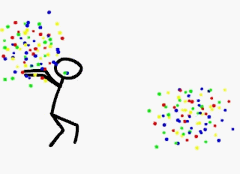

# Dotfiles .:.



My config files for macOS, Linux, Windows, and WSL, managed with
[`chezmoi`](https://www.chezmoi.io/). `chezmoi` renders the real files from
[Go templates](https://masterminds.github.io/sprig/) instead of symlinking, so
one branch covers every machine.

## Install

macOS / Linux / WSL:

```sh
sh -c "$(curl -fsLS https://raw.githubusercontent.com/nixpulvis/dotfiles/master/install.sh)"
```

Windows (PowerShell):

```powershell
irm https://raw.githubusercontent.com/nixpulvis/dotfiles/master/install.ps1 | iex
```

Both install `chezmoi` to `~/.local/bin` if it's missing, then run
`chezmoi init --apply nixpulvis`. On macOS, `install.sh` first installs the
Xcode Command Line Tools, since a new Mac has no working git. Extra arguments go
to `chezmoi init`, so `./install.sh --branch <branch>` tracks a branch.

If `chezmoi` is already installed:

```sh
chezmoi init --apply nixpulvis
```

## Features

Everything beyond the shells and git is split into features: a set of
packages plus the files that configure them, switched on or off as a unit.
They're defined in one table,
[`home/.chezmoidata/features.yaml`](home/.chezmoidata/features.yaml):

```yaml
neovim:
  enabled: true
  requires: [vim]                          # vim holds the shared color scheme
  targets: [.config/nvim, AppData/Local/nvim]
  packages:
    neovim: {brew: neovim, pacman: neovim, apt: neovim, winget: Neovim.Neovim}
```

| Key        | Meaning                                                                 |
| ---------- | ----------------------------------------------------------------------- |
| `enabled`  | Required. The default, overridable per environment and per machine.     |
| `group`    | Another feature that must also be on (`graphical` for alacritty, fonts, zed, wm). |
| `os`       | The OSes it applies to. Default: all.                                   |
| `requires` | Features that must be on whenever this one is; rendering fails otherwise. |
| `targets`  | Paths under `~` that are managed only while it's on.                     |
| `packages` | Package name to `brew`, `brew_cask`, `pacman`, `apt`, `winget` names.    |

`core` (bash, the `~/.config/sh` files shared with zsh, and git) is always on.
The rest: `fish`, `zsh`, `vim`, `neovim`, `rust`, `clang`, `ripgrep`, `fd`,
`bat`, `fzf`, `eza`, `delta`, `cli` (jq, dust, fortune), `worktrunk`,
`weechat`, `pass`, `backup`, `omp`, `sshAgent`, `graphical`, `alacritty`,
`fonts`, `zed`, `wm` and `shareNetwork`.

[`home/.chezmoitemplates/features`](home/.chezmoitemplates/features) resolves
which are on for this machine: `enabled`, its `os`, and its `group`. It also
checks `requires`, which is kept for real breakage (Neovim loads its color
scheme from `~/.vim`, the backup script reads its passphrase with `pass`).
Config that merely uses another tool checks for it when it runs, or falls back
when the tool's feature is off: `EDITOR` becomes `vim` without `neovim`, git's
diff tool `vimdiff`, the `l`/`ll`/`la` aliases plain `ls`, and Alacritty starts
the login shell without `fish`. Templates use the result as
`{{ $f := includeTemplate "features" . | fromJson }}`, `.chezmoiignore`
skips the targets of features that are off, the install scripts install only
enabled features' packages, and [`shell.yaml`](home/.chezmoidata/shell.yaml)
entries can name a `feature`.

A feature's settings come from three places, later ones winning:

1. `features.yaml` here.
2. Later `.chezmoidata/` files, e.g. a consuming repository's
   `.chezmoidata/zz-env.yaml` (see [Overlays](#overlays)). Files merge key by
   key in name order, so `features: {zed: {enabled: false}}` only touches
   zed. Lists are replaced whole, which is why `packages` is a map: set one to
   `null` to drop it.
3. This machine's chezmoi config, where `chezmoi init` stores its answers.

`chezmoi init` asks for git name, email, and signing key, and these:

| Question                    | Key                         | Asked on     | Default                    |
| --------------------------- | --------------------------- | ------------ | -------------------------- |
| Graphical machine?          | `features.graphical`        | Linux        | no on WSL, else yes        |
| Window-manager stack?       | `features.wm`               | Linux        | no; yes implies graphical  |
| Install omp?                | `features.omp`              | all          | yes                        |
| Set up WeeChat? (and nick)  | `features.weechat`          | macOS, Linux | macOS yes, Linux graphical |
| Install software?           | `installPackages`           | all          | yes                        |

`graphical` is always on for macOS and Windows. `installPackages` isn't a
feature: no means config only, with no packages, omp download or Windows fonts.
The answers are saved per machine and reused on later runs. Use
`chezmoi init --prompt` to answer them again.

`.chezmoi.toml.tmpl` is the template for this machine's `chezmoi` config,
`~/.config/chezmoi/chezmoi.toml`. `chezmoi init` renders it, which asks the
questions above and detects WSL, and saves the results in the config's `[data]`
section. It can't read `.chezmoidata`, so a consuming repository can't change
these questions' defaults. Only `chezmoi init` renders it, so when it changes
(your edit or a pull) the saved config is stale until you re-run init. The
`run_before_00-config-drift-check` script catches this and prints a banner.
`chezmoi apply` keeps going, `chezmoi update` stops. Run `chezmoi update --init`
(or `chezmoi init`) to regenerate the config from your saved answers.

### Packages

`run_once_after_10-install-packages.{sh,ps1}.tmpl` installs the enabled
features' packages with Homebrew on macOS, `pacman` or `apt` on Linux, and
`winget` on Windows. Leave out a manager's key and the package is skipped
there. To add a tool, add it to a feature's `packages` in `features.yaml`.

omp (the oh-my-pi coding agent) isn't in any distro repo or winget. macOS gets
it from a Homebrew tap (the omp feature's package). Linux and Windows download a
pinned release binary into `~/.bin` with
`run_once_after_15-install-omp.{sh,ps1}.tmpl`. To upgrade, bump the version and
checksums in [`home/.chezmoidata/omp.yaml`](home/.chezmoidata/omp.yaml).

Neovim's language servers come with the features for their languages. `neovim`
installs lua-language-server, for its own config. Debian/Ubuntu have no package
for it, so Linux without pacman downloads a pinned release with
`run_once_after_16-install-lua-language-server.sh.tmpl`
([`home/.chezmoidata/lua-language-server.yaml`](home/.chezmoidata/lua-language-server.yaml)).
`rust` installs rustup, then the package script installs the stable toolchain
if there's none, and the rust-analyzer and rust-src components, which match the
toolchain that way. Homebrew's rustup is keg-only, so `shell.yaml` puts its
`bin` on PATH. `clang` installs clang and clangd; macOS has both from the Xcode
Command Line Tools, and Windows gets neither, since LLVM's package doesn't put
them on PATH.

Zed has no apt package, and worktrunk none on apt or winget, so they aren't
installed there.

## Overlays

Another chezmoi source repository can build on this one (for example by
merging it) and add to or take away from it without editing its files.

**Adding.** A consuming repository adds a template at
`home/.chezmoitemplates/overlay/<target path>`. The public file renders it with
the same data and appends it at the end. Overlays are optional, and
`.chezmoitemplates` never reaches `$HOME`.

| Target                       | Overlay                                                  |
| ---------------------------- | -------------------------------------------------------- |
| `~/.gitconfig`               | `home/.chezmoitemplates/overlay/.gitconfig`              |
| `~/.gitignore`               | `home/.chezmoitemplates/overlay/.gitignore`              |
| `~/.config/sh/rc.sh`         | `home/.chezmoitemplates/overlay/.config/sh/rc.sh`        |
| `~/.config/fish/config.fish` | `home/.chezmoitemplates/overlay/.config/fish/config.fish` |
| `~/.config/nvim/init.lua`    | `home/.chezmoitemplates/overlay/.config/nvim/init.lua`   |
| `.chezmoiignore` patterns    | `home/.chezmoitemplates/overlay-chezmoiignore`           |

Being last, an overlay's settings win where the format allows: git's last value,
a redefined shell alias, Lua run after the rest of `init.lua` (errors in it
still show). chezmoi doesn't allow a `.chezmoiignore` inside
`.chezmoitemplates`, hence that one's name. Only files with the hook support an
overlay. To add one, end the template with:

```gotemplate
{{- includeTemplate "overlay-hook" (dict "path" ".config/foo/bar.toml" "data" .) }}
```

**Taking away.** Turn features off in a `.chezmoidata/` file of its own (see
[Features](#features)): that drops their files, packages and the config that
depends on them. To drop single files, list them in the `.chezmoiignore`
overlay. If public config needs to be removable in finer pieces, add a feature
or a `feature:` key for it here rather than working around it there.

Machine-specific identity and feature choices (git name and email,
`graphical`, `installPackages`, ...) belong in chezmoi's generated local config
from `chezmoi init`, not in an overlay or the repository.

A consuming repository shouldn't edit files this repository manages. Use an
overlay or a data file, or deliberately take over the whole file and own it
from then on.

## Layout

```
.chezmoiroot                 points chezmoi at home/
install.sh / install.ps1     bootstrap scripts
home/                        chezmoi source (renders to ~/)
  .chezmoi.toml.tmpl         per-machine questions
  .chezmoiignore             feature and OS gating
  .chezmoidata/              features.yaml, shell.yaml, weechat.yaml, and install
                             pins: omp.yaml, fonts.yaml, lua-language-server.yaml
  .chezmoitemplates/         feature resolver, package lists, overlay hook, shared
                             shell settings renderer, WeeChat merge script
  dot_*                      files that become ~/.*
  run_before_*               config drift check, runs on every apply
  run_once_*                 one-time setup scripts
  run_onchange_*             setup that reruns when its inputs change
  AppData/                   Windows config-path symlinks (see below)
  private_Library/           macOS launch agents
test/                        sandbox.sh (throwaway HOME), docker.sh (Linux container)
.github/workflows/test.yml   CI: sandbox.sh on macOS + Linux, docker.sh on Arch + Ubuntu
```

## Daily use

```sh
chezmoi edit ~/.gitconfig    # edit the source for a file
chezmoi diff                 # preview changes to $HOME
chezmoi apply                # write changes to $HOME
chezmoi update               # git pull + apply
chezmoi cd                   # shell in the source dir, then git commit/push
```

## Windows

On Windows, Neovim and Alacritty read their config from `%LOCALAPPDATA%` and
`%APPDATA%` instead of `~/.config`. `home/AppData/Local/symlink_nvim.tmpl` and
`home/AppData/Roaming/symlink_alacritty.tmpl` create symlinks from there back to
`~/.config`, so the config only lives in `dot_config/`. Making symlinks on
Windows needs Developer Mode (Settings > Privacy & security > For developers)
or an elevated shell.

The Unix shell files (`.bash_profile`, `.bashrc`, `.zshrc`, `~/.config/sh`,
fish, `~/.bin`) are still written on Windows. Git Bash reads `.bash_profile`
and `.bashrc` (and through them `~/.config/sh`), otherwise they do nothing. WSL
counts as Linux.

## Notes

Git identity (personal or work email, signing key) comes from the `init`
prompts and is templated into `~/.gitconfig`. System setup like locale,
`sudoers`, and `pacman.conf` isn't managed here.

### Shells

fish is the main shell, and bash and zsh are set up to match it. Settings that
apply to all three (PATH, environment variables, aliases, fzf options) live once
in [`home/.chezmoidata/shell.yaml`](home/.chezmoidata/shell.yaml), along with
fish's greeting, which bash and zsh don't print.
`home/.chezmoitemplates/shell-shared` renders them in each shell's syntax into
`dot_config/fish/config.fish.tmpl` and, for bash and zsh,
`dot_config/sh/env.sh.tmpl` (environment; also loaded by non-interactive bash)
and `dot_config/sh/rc.sh.tmpl` (interactive setup). Shared values are written
in double quotes, which mean the same in both syntaxes, so they can't contain
`"`, `\` or backticks; rendering fails if one does.

Those three files, `.bashrc` and `.zshrc` keep only what needs per-shell code:
prompts, tool hooks (`fzf --fish`, `rbenv init`, Git Bash's ssh-agent), and
zsh's history and completion.

Shells never start their own ssh-agent elsewhere, since one started from a
terminal outlives it (and on macOS keeps the terminal listed as "Running in
Background"). macOS's launchd provides `SSH_AUTH_SOCK`. On Linux,
`dot_config/systemd/user/ssh-agent.service` runs one agent per login, enabled
by `run_onchange_after_21-ssh-agent.sh.tmpl`, and `shell.yaml` points
`SSH_AUTH_SOCK` at it unless it's already set (e.g. a forwarded agent). Git
Bash has no such agent, so its first shell starts one and records it in
`~/.ssh/agent.env` for the others to reuse.

### Colors

Alacritty, Vim/Neovim and Zed share one color scheme, `nixpulvis`, built from
the terminal's own palette:

- `dot_config/alacritty/nixpulvis-dark.toml` and `nixpulvis-light.toml` set
  what each terminal color looks like. Both import `nixpulvis-indexed.toml`,
  so the 256-color grays are the same in either mode.
- `dot_vim/colors/nixpulvis.vim` decides which terminal color each thing gets,
  by number only. Neovim loads it from `~/.vim` with `termguicolors` off.
- `dot_config/zed/themes/nixpulvis.json` is generated from those two by
  `~/.config/zed/build-nixpulvis-theme`. After changing either, run it, then
  `chezmoi re-add ~/.config/zed/themes/nixpulvis.json`.

Alacritty imports `~/.config/alacritty/colors.toml`, a link to one of the two
palettes. On macOS, `run_onchange_after_20-alacritty-color-mode.sh.tmpl` builds
`dot_config/alacritty/alacritty-color-mode.swift` into `~/.bin` and loads it as
a login agent (`private_Library/LaunchAgents/`), which repoints the link
whenever the system appearance changes. `chezmoi` leaves the link alone there.
Elsewhere it's a fixed link to the dark palette.

omp only notices a light/dark change on its own in terminals that announce it
(or WezTerm), which Alacritty and Zed don't.
`dot_omp/private_agent/extensions/color-mode.ts` watches the same link and
switches omp between its `theme.dark` and `theme.light` themes.

Vim and Neovim take 'background', which picks the scheme's grays, from the
terminal's background color: they ask at startup and again whenever the window
regains focus, so they follow either terminal without watching anything.

### WeeChat

WeeChat connects to a ZNC bouncer (ref8.net) instead of Libera directly. ZNC
holds the Libera credentials, stays connected, and replays history. The bouncer
address and its pinned TLS fingerprint are in
`home/dot_config/weechat/modify_private_irc.conf.tmpl`. Edit them there if the
bouncer moves or its cert changes.

WeeChat owns its config files, so `chezmoi` uses `modify_` scripts instead of
plain files. On each apply they rewrite only the lines `chezmoi` manages and pass
the rest through unchanged. On a new machine they write a minimal file. The
shared logic is in `home/.chezmoitemplates/weechat-merge-conf`.

- `modify_private_irc.conf.tmpl` manages the `znc.*` server lines: address,
  TLS, nick, the password reference, autoconnect, and autojoin.
- `modify_private_sec.conf.tmpl` sets `sec.crypt.passphrase_command` so WeeChat
  gets its secured-data passphrase from the OS keyring and doesn't prompt on
  launch.

The channel list is in
[`home/.chezmoidata/weechat.yaml`](home/.chezmoidata/weechat.yaml) and is
applied to `znc.autojoin` on every `chezmoi apply`. Listed channels are always
joined. Channels you `/join` by hand stay joined on ZNC until you `/part` them.

No password is stored in this repo or in the keyring. If you answer yes to the
WeeChat question, `run_once_before_05-weechat-sec-passphrase.sh.tmpl` generates a
random passphrase and stores it in the keyring (service `weechat`, user = your
IRC nick) before any files are written. If one already exists it's kept, since
a new one would make existing secrets unreadable. You then store the ZNC
password once, encrypted in `sec.conf`:

```sh
env WEECHAT_PASSPHRASE="$(chezmoi secret keyring get --service weechat --user <nick>)" weechat
```

and inside WeeChat:

```
/secure set znc <ZNC password>
/save
```

The first encrypted entry needs the passphrase in the environment. After that,
plain `weechat` works. `irc.conf` already points the password at
`${sec.data.znc}`. Check the connection with `/msg *status ListNetworks`. The
package install script prints these steps too.

The keyring has to be one the `chezmoi` CLI can reach: the login keychain on
macOS (not iCloud Keychain or Passwords.app), or a running Secret Service
provider (gnome-keyring or kwallet) on Linux. If no keyring is available the
passphrase script skips itself and prints how to retry. On headless machines,
answer no to the WeeChat question, which leaves out WeeChat entirely.
